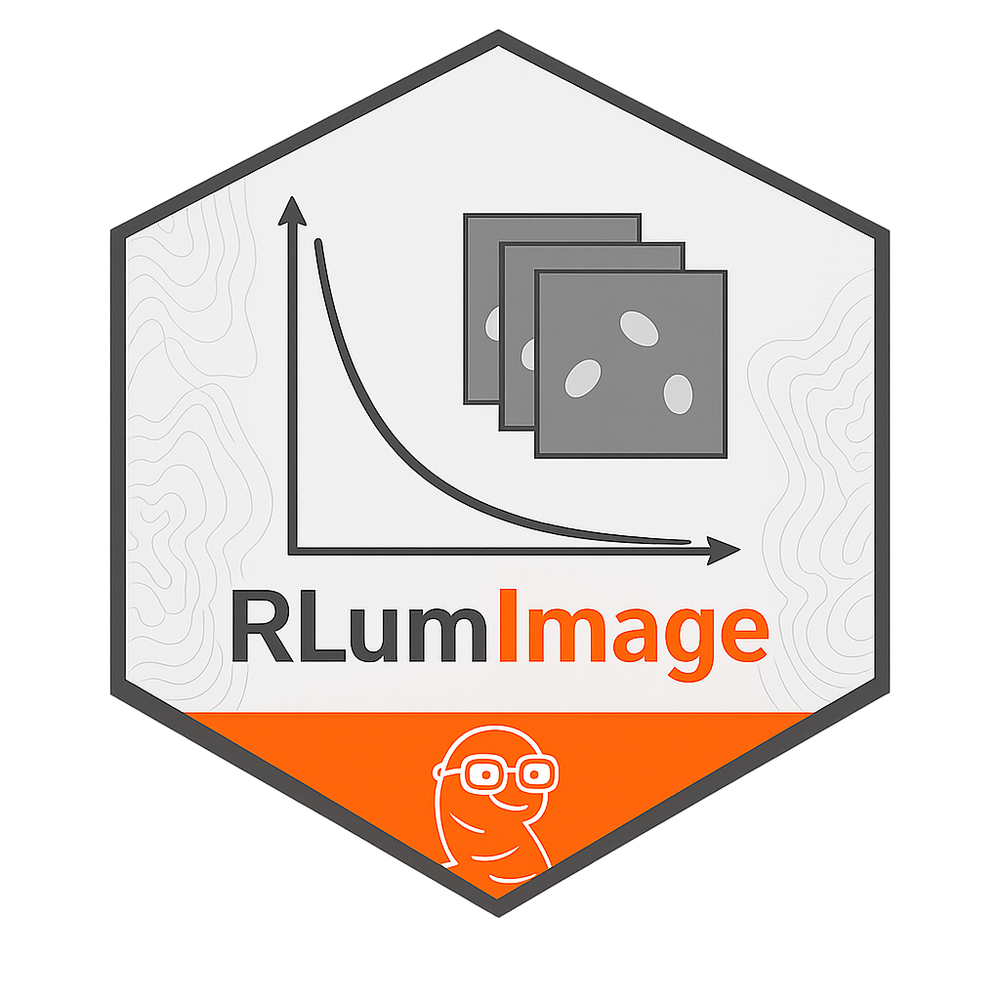

# RLumImage 

[](https://github.com/R-Lum/RLumImage/actions)

[R-Lum network](https://r-luminescence.org) package for processing luminescence images of sediments, rock slices, natural dosimeters and more.

This library builds upon the R package `terra` and is furthermost designed to process optically- and thermally stimulated luminescence (OSL, IRSL, TL) and radiofluorescence (RF) image data as used in the fields of geomorphology and archaeology. As input data, raw image data from Freiberg Instruments lexsyg research OSL/TL/RF readers and from DTU Nutech Risø OSL/TL/IRPL readers are supported. Output data are `RLum`-class objects or XLUM files which can be further analysed with the R package `Luminescence`.

## Installation

To install the latest development build directly from GitHub, run:

```         
if (!require("pak"))
  install.packages("pak")
pak::pkg_install("R-Lum/RLumImage")
```

At least the pre-build version `1.3.1.9000-1` of the `Luminescence` package is required.

```         
pak::pkg_install("R-Lum/Luminescence")
```

## Current development status

(2026-11-16)

| Function | Description |
|------------------------------------|------------------------------------|
| `import_lexsyg_images` | Reads a *Freiberg Instruments lexsyg* measurement file (\*.xsyg) using `Luminescence::read_XSYG2R`. Relates the meta data of the recorded steps to those image files in the same folder whose time stamps match the records. |
| `align_images` | Automatically estimates the horizontal shift, vertical shift, and rotation angle that best aligns a 'moving' single-layer image onto a 'fixed' one, using image correlation and `optim()`. |
| `apply_fft_filter` | Applies a Fast Fourier Transform (FFT) filter to one or multiple grey-scale image layers, acting as a short-pass, long-pass, or band-pass filter on spatial frequencies. Filter edges are smoothed with a cosine taper. Can be used, e.g., to remove signal cross-talk between grains. |
| `apply_image_alignment` | Applies the shift/rotation parameters estimated by `align_images` to a full image stack. |
| `apply_median_grouping` | Combines every *N* images of a stack into a median image. This removes X-ray speckles in RF images and reduces the amount of data. |
| `apply_rois` | Extracts mean values within regions of interest (ROIs) across an image stack and generates a list of `RLum.Analysis.ROI` objects. |
| `as.SpatRaster` | Converts file paths, arrays, matrices to a `terra::spatRaster` object. Is just a simple wrapper for `terra::rast()` but ensures image validity inside RLumImage environment. |
| `find_grains` | Automatically detects single grains (local signal maxima) in an image. It FFT-filters the image via `apply_fft_filter()` to smooth grain-like structures, then iteratively finds the pixel of maximum signal, defines a circular ROI around it, and removes it before searching for the next maximum. Grains are kept only if their mean signal within the ROI exceeds the estimated local background by a given `threshold` (or a threshold derived from a target `grain.density`). Returns ROIs in the format of `set_roi()` / `apply_rois()`. |
| `get_sections` | Returns and plots single columns or rows (lines) of an image stack. |
| `get_signal_range` | Returns recommended lower and upper signal value boundary for plotting one or multiple images of a stack. Helper function for plotting functions. |
| `plot_image` | Plots one or multiple images. Is just a wrapper for `terra::plot` but adds some extra fluff like optional colouring depending on the acquisition wavelength, and can overlay circular ROIs (with class colours and optional ID numbers). |
| `plot_image_difference` | Computes and plots the pixel-wise difference between two images (objA - objB) using `plot_image`. |
| `plot_RLum` | Plot `RLum.Analysis.ROI` objects. |
| `print_sequence` | Extracts the sequence table of an imported imaging measurement. Measurement duration is calculated from the actual time difference between first and last images rather than the theoretical sequence duration, which can reveal issues with acquisition or image-sequence assignment. |
| `rescale_image` | Zooms in or out or moves an image's centre while maintaining its dimensions. Works also with image stacks. |
| `rotate_image` | Rotates an image while maintaining its dimensions. Works also with image stacks. |
| `select_grains` | Opens a shiny app that lets the user place circular ROIs on a reference image (combined as the pixel-wise mean of the stack), assign a mineral class to each, and optionally detect grains automatically via `find_grains()`. Returns per-grain ROI objects in the format of `set_roi()` / `apply_rois()`. |
| `set_roi` | Creates a new region of interest (ROI) object (pixel `mask`, position, `shape`, mineral `class`, optional `info`/`overlay`/`curves`) or edits an existing one. Underlies the ROI objects used by `apply_rois()`, `find_grains()` and `select_grains()`. |
| `shift_image` | Shifts an image's position while maintaining its dimensions. Works also with image stacks. |
| `wavelength_to_rgb` | Converts a wavelength into an RGB value. Helper function for plotting functions. |
| `write_rf_table` | Saves single-grain IR-RF measurements as a `*.rf` file (Mittelstrass & Kreutzer 2021) with `<Statistics>`, `<Natural>` and `<Bleached>` blocks. Draws on natural and bleached dose curves stored in a list of ROIs (as returned by `apply_rois()`) and can be filtered by mineral class. Open the file with `Luminescence::read_RF2R()`. |

## License

This program is free software: you can redistribute it and/or modify it
under the terms of the GNU General Public License as published by the
Free Software Foundation, either version 3 of the License, or any later
version.

This program is distributed in the hope that it will be useful, but
WITHOUT ANY WARRANTY; without even the implied warranty of
MERCHANTABILITY or FITNESS FOR A PARTICULAR PURPOSE. See the [GNU
General Public
License](https://github.com/R-Lum/RLumImage/blob/main/LICENSE) for
more details.

## Funding

- Since 08/2025: Dirk Mittelstraß as maintainer of the package is gratefully funded through the DFG project “ARENICOLA: Advanced RadiofluorescENce Imaging and grain Classification in Luminescence Applications” [No 528704761](https://gepris.dfg.de/project/553815036?lang=en) led by Dr Sebastian Kreutzer (PI at the LIAG Institute for Applied Geophysics, Hannover, DE) and Dr Margret Fuchs (PI at the Helmholtz Institute Freiberg for Resource Technology (HIF), Freiberg, DE).

- Since 11/2026: Dr Marco Colombo is funded through the DFG programme “REPLAY: REProducible Luminescence
  Data AnalYses” [No 528704761](https://gepris.dfg.de/project/528704761) led by Dr Sebastian Kreutzer (PI at LIAG - Institute for Applied Geophysics, Hannover, DE) 
  and Dr Thomas Kolb (PI at Justus-Liebig-University Giessen, DE).
  
- All other authors gratefully received additional funding from various public funding bodies.
